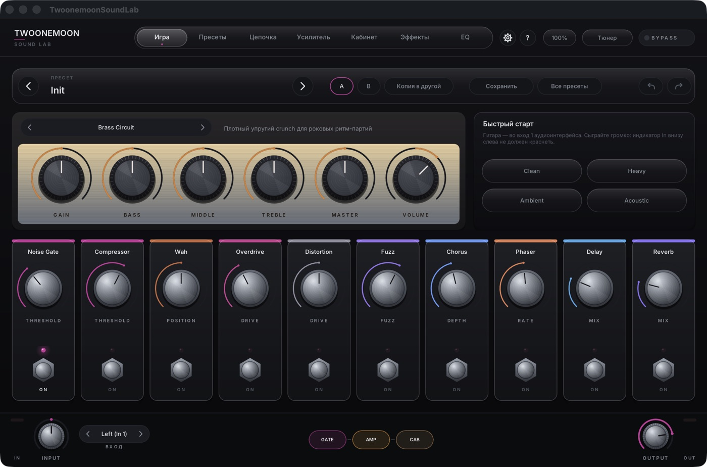
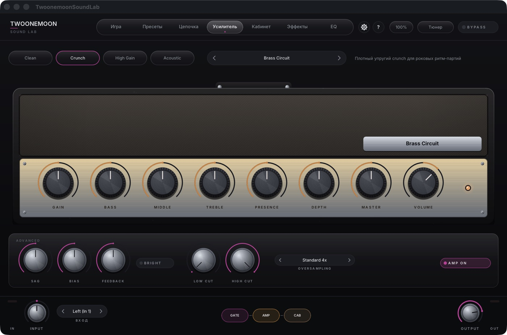
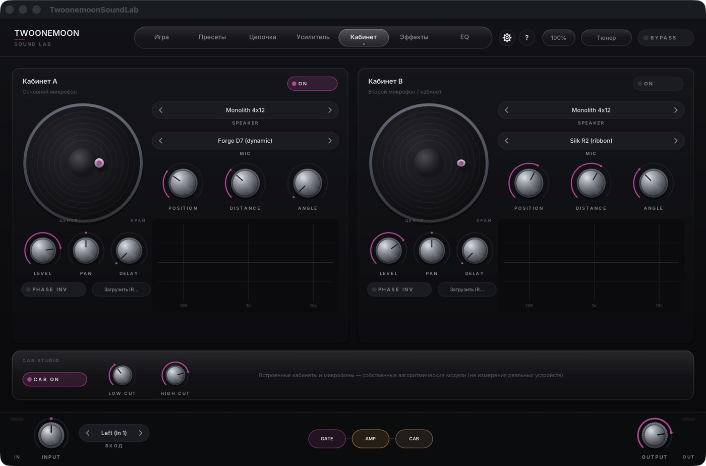
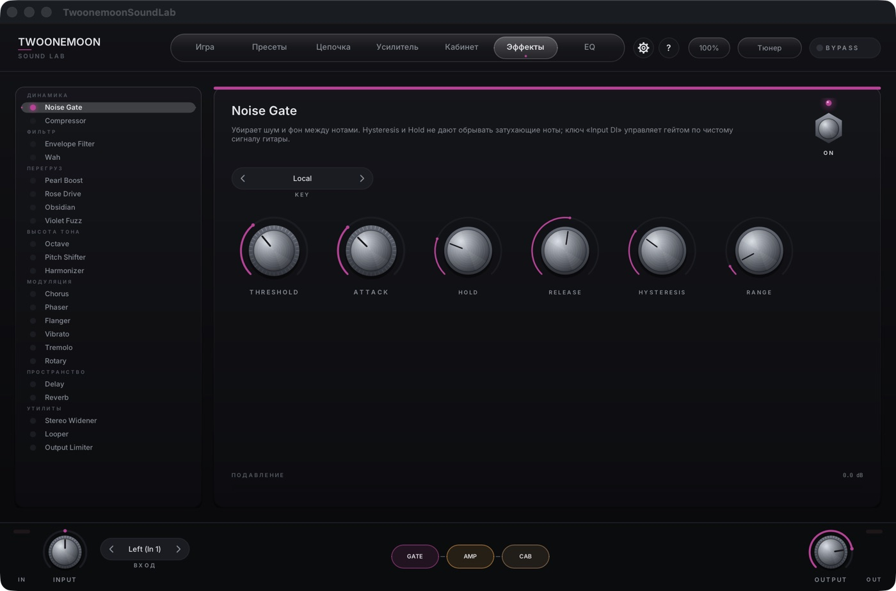
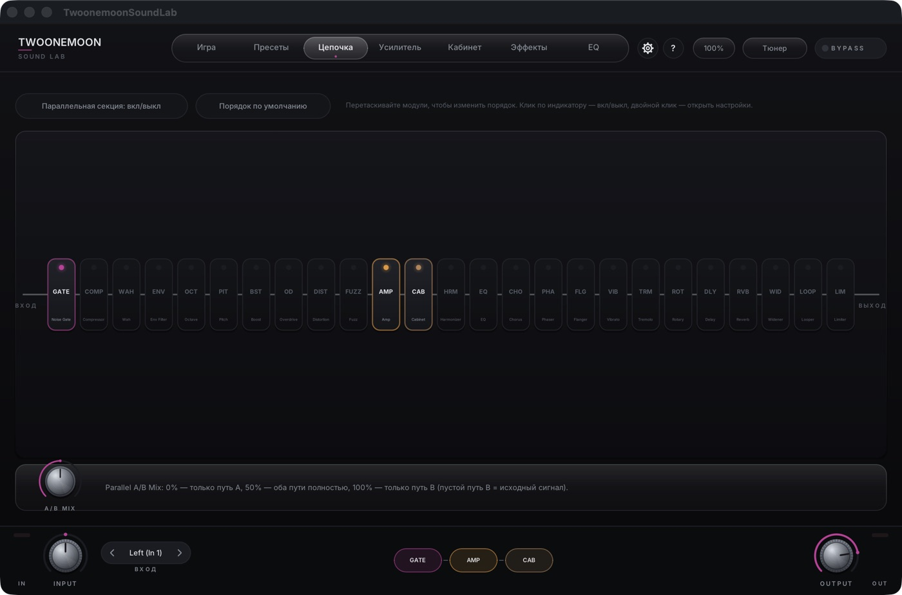
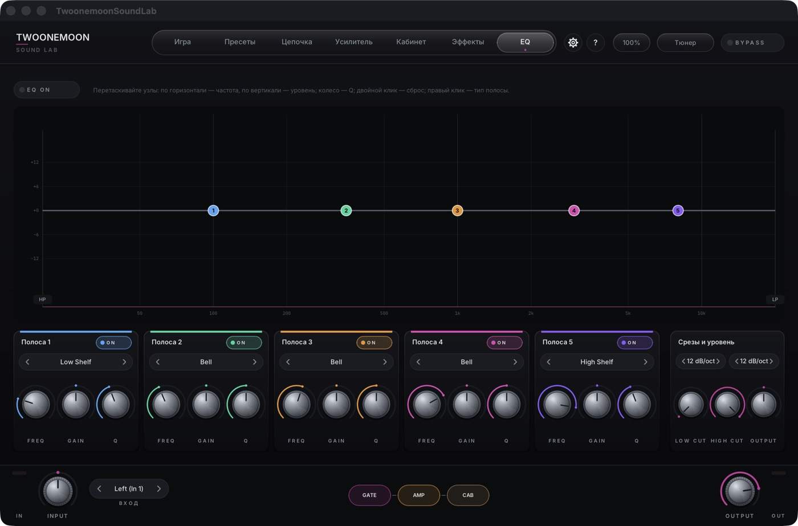
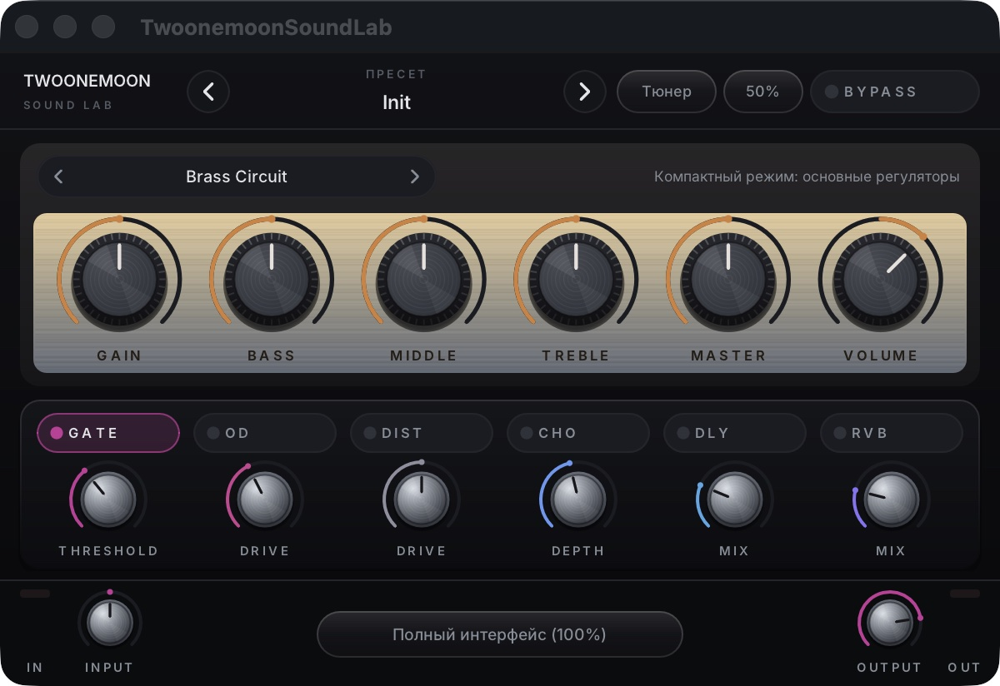

# TwoonemoonSoundLab

Бесплатный гитарный процессор с открытым исходным кодом для macOS на Apple Silicon: усилители, кабинеты,
педали и эффекты для игры и записи через аудиоинтерфейс. Форматы: **AUv2, VST3, CLAP и самостоятельное приложение**,
один установщик.



> **Статус: 0.1.0, тестовая версия.** Все заявленные модули реализованы, собираются и проходят автоматические
> проверки (68 тестов ядра, auval, VST3 validator, pluginval, clap-validator). Звучание **ещё не прослушано на реальной
> гитаре**, плагин не проверялся вручную в DAW, сборки не подписаны Developer ID. Подробно — [docs/PROGRESS.md](docs/PROGRESS.md)
> и [docs/TESTING.md](docs/TESTING.md).

## Возможности

* **12 оригинальных усилителей** — clean, crunch, high gain, acoustic; каскады триодов, пассивный темброблок,
  двухтактный оконечный каскад с Bias, Sag и обратной связью (Presence/Depth); у каждой модели свой фасад.
* **Cab Studio** — 6 кабинетов × 3 микрофона (синтезированные модели), положение микрофона на диффузоре, два слота,
  загрузка своих WAV IR, свёртка без задержки.
* **Эффекты** — Noise Gate, Compressor, Boost, Overdrive, Distortion, Fuzz, Wah, Envelope Filter, Octave, Pitch Shifter,
  4-голосный Harmonizer, Chorus, Phaser, Flanger, Tremolo, Vibrato, Rotary, Delay (5 режимов), Reverb (5 режимов +
  Freeze), 5-полосный EQ с анализатором, Stereo Widener, Output Limiter, Looper, метроном.
* **Цепочка** — перетаскивание модулей, параллельная секция A/B.
* **60 пресетов** с выровненной громкостью, избранное, поиск, A/B, отмена/повтор.
* **Тюнер**, **MIDI Learn** и педаль экспрессии, **масштаб 50–250%** (50% — компактный режим), справка и подсказки.
* **Без задержки** в основной цепочке (хосту сообщается 0); типичная цепочка ~2–3% одного ядра M1, все модули сразу ~7%.
* Без телеметрии, регистрации и сетевых запросов.

| | |
|---|---|
|  |  |
|  |  |
|  |  |

## Установка

1. Скачайте или соберите `TwoonemoonSoundLab-Installer.pkg` и откройте его.
2. По умолчанию плагины ставятся в `/Library/Audio/Plug-Ins/{Components,VST3,CLAP}`, приложение — в `/Applications`
   (нужен пароль администратора); без пароля — «Установить только для меня».
3. Перезапустите DAW или выполните повторное сканирование плагинов.

**Gatekeeper.** Текущие сборки подписаны ad-hoc и не нотаризованы. На другом Mac macOS может сообщить, что не удаётся
проверить разработчика: откройте пакет через контекстное меню «Открыть» или разрешите в «Конфиденциальность и
безопасность». Отключать Gatekeeper не нужно. Подписанные и нотаризованные сборки возможны по процедуре
[docs/RELEASE.md](docs/RELEASE.md).

Подробно — [docs/INSTALLATION.md](docs/INSTALLATION.md). Удаление — `Uninstall TwoonemoonSoundLab.command`
(пресеты сохраняются).

## Требования

* Mac на Apple Silicon (M1 и новее), macOS 12+ (проверено на macOS 26.6.2, M1).
* Аудиоинтерфейс с инструментальным входом для игры на гитаре.

## Сборка из исходников

```bash
git clone https://github.com/twoonemoon/TwoonemoonSoundLab.git
cd TwoonemoonSoundLab
Scripts/bootstrap.sh       # закреплённые SDK (iPlug2, VST3, CLAP)
Scripts/build.sh Release   # AUv2, VST3, CLAP, standalone → build/release/out
Scripts/test.sh            # тесты ядра
Scripts/package.sh         # установщик → dist/TwoonemoonSoundLab-Installer.pkg
```

Нужны Command Line Tools, CMake и Ninja; полный Xcode не обязателен. Подробно — [docs/BUILDING.md](docs/BUILDING.md).

## Документация

| Документ | О чём |
|---|---|
| [USER_GUIDE](docs/USER_GUIDE.md) | подключение, экраны, усилители, кабинеты и IR, эффекты, пресеты, MIDI |
| [INSTALLATION](docs/INSTALLATION.md) | установщик, пути плагинов, обнаружение в DAW, удаление |
| [TROUBLESHOOTING](docs/TROUBLESHOOTING.md) | звук, DAW, установка, сборка |
| [ARCHITECTURE](docs/ARCHITECTURE.md) | компоненты, потоки, модель данных |
| [DSP_DESIGN](docs/DSP_DESIGN.md) | алгоритмы, задержка, ограничения |
| [ART_DIRECTION](docs/ART_DIRECTION.md) | дизайн-язык |
| [HELP_CONTENT](docs/HELP_CONTENT.md) | встроенная справка и подсказки |
| [TESTING](docs/TESTING.md) / [PROGRESS](docs/PROGRESS.md) | что проверено, статус, известные ограничения |
| [BUILDING](docs/BUILDING.md) / [RELEASE](docs/RELEASE.md) | сборка, подпись, нотаризация, выпуск |
| [DECISIONS](docs/DECISIONS.md) / [LICENSES_AND_ASSETS](docs/LICENSES_AND_ASSETS.md) | решения и лицензии |
| [CHANGELOG](CHANGELOG.md) | изменения |

## Лицензия

GPL-3.0-or-later — [LICENSE](LICENSE). Сторонние компоненты — [THIRD_PARTY_NOTICES.md](THIRD_PARTY_NOTICES.md).
Модели усилителей, кабинетов и эффектов — оригинальные; названия не имитируют продукты других производителей.
